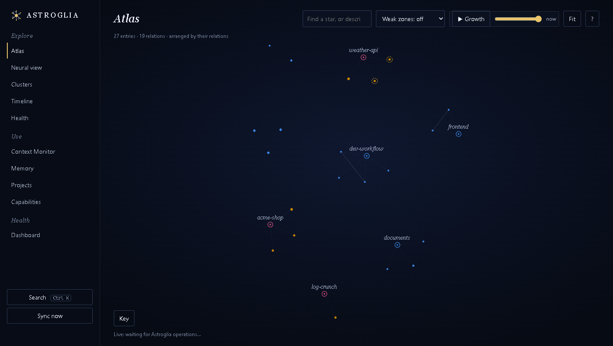
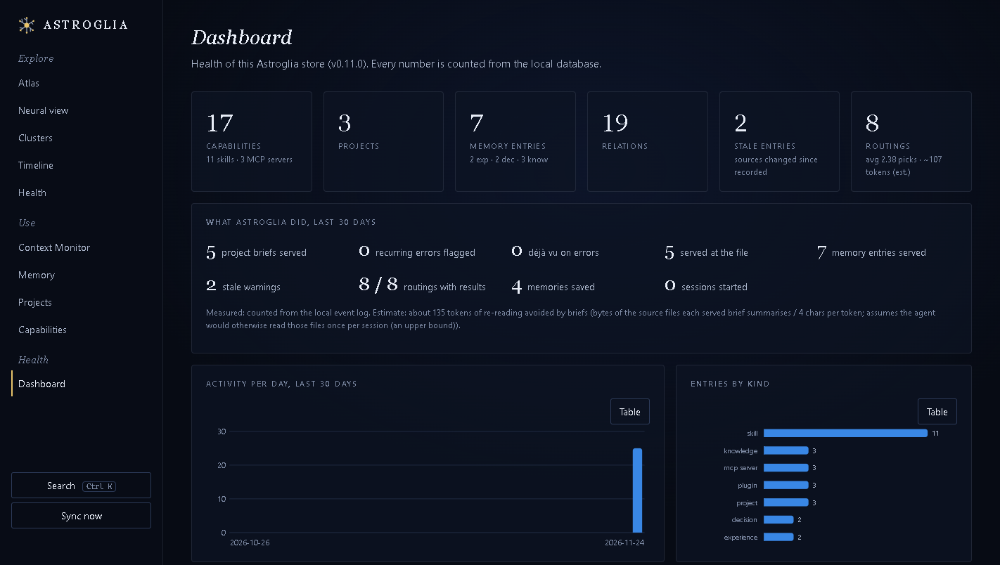
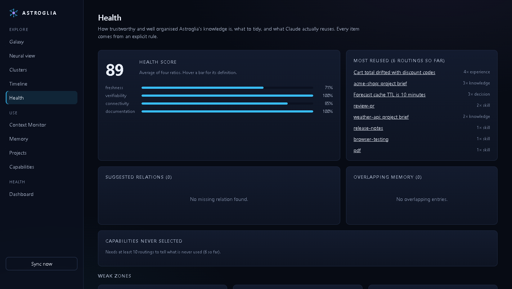
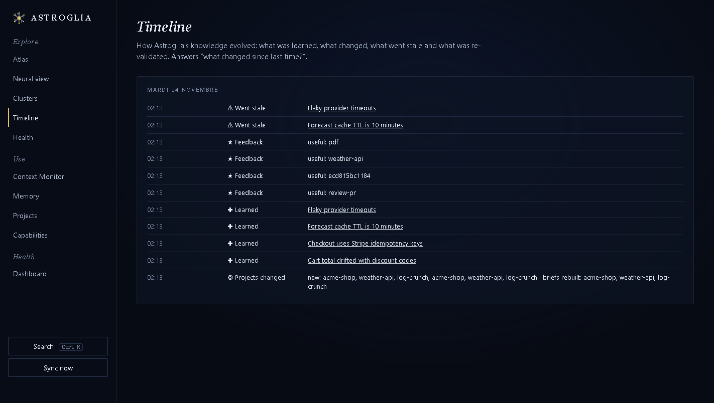

<p align="center"></p>

<h1 align="center">Astroglia</h1>

<p align="center"><b>Claude Code dispose déjà de dizaines de skills, plugins et serveurs MCP, et redécouvre vos projets à chaque session.<br>
Astroglia lui dit quelles ressources conviennent à la tâche, ce qu'il a déjà appris, et si c'est encore vrai.</b></p>

<p align="center">Local · aucun appel à un LLM · aucun cloud · Apache-2.0 · <a href="README.md">English</a></p>



*Les captures utilisent le jeu de données de démonstration fourni (`python bench/demo_seed.py <dossier>`), pas un usage réel.*

## Pourquoi

| À chaque session, Claude… | Avec Astroglia |
|---|---|
| relit `package.json`, le README et l'arborescence pour se rappeler ce qu'est un projet | reçoit une **fiche projet** dans le manifeste de démarrage (stack, commandes, points d'entrée, tests, fichiers les plus modifiés), construite depuis ces fichiers et reconstruite seulement quand ils changent |
| voit plus de 40 descriptions de skills et choisit au jugé ; des skills redondants sont chargés deux fois | appelle **`route(tâche)`** : une courte liste classée, avec la raison de chaque choix et de chaque rejet, sans doublons |
| oublie la correction trouvée hier, ou pire, se fie à une note sur du code qui a changé depuis | **`remember`** lie chaque note à l'empreinte de ses fichiers ; quand ils changent, la note est servie marquée **périmée** |
| ouvre `cache.py` sans savoir qu'une décision passée explique pourquoi le TTL vaut 600 | **mémoire ancrée** : ce qu'Astroglia sait d'un fichier arrive *quand Claude lit ce fichier*, sans aucune requête, marqué périmé si le fichier a changé ; le modifier liste les décisions qui risquent de ne plus tenir |
| retombe sur une erreur déjà corrigée la semaine dernière et repart de zéro | **déjà-vu** : quand une commande échoue, Astroglia vérifie si cette erreur a déjà été résolue et mémorisée, et le dit (silencieux sauf correspondance forte : 0 fausse alerte sur 35 erreurs réelles) |
| rouvre un projet sans savoir où la dernière session s'est arrêtée | une **note de reprise** dans le manifeste de démarrage : dernière demande, fichiers modifiés, dernière erreur rencontrée, tirées du transcript de la session précédente |
| termine une longue session et la connaissance est perdue | un **hook de fin de session** demande une seule fois, seulement après un vrai travail, s'il y a quelque chose à garder |

Les astrocytes sont les cellules du cerveau en forme d'étoile qui soutiennent les neurones sans penser à leur place. Astroglia ne pense pas pour Claude : il organise ce que Claude possède déjà.

## Installation

Python ≥ 3.11 et Claude Code. Installez d'abord la commande `astroglia` :

```bash
pipx install git+https://github.com/ThyZ0/astroglia
```

Puis choisissez **une seule** façon de la brancher (pas les deux, sinon les hooks s'exécutent deux fois) :

```text
# A. Comme plugin Claude Code (recommandé) : dans Claude Code
/plugin install astroglia --marketplace ThyZ0/astroglia
```

```bash
# B. Sans le système de plugins : modifie ~/.claude/settings.json (sauvegardé) et enregistre le serveur MCP
astroglia install          # simulation : affiche exactement ce qui va changer
astroglia install --yes
```

Redémarrez Claude Code. `astroglia doctor` vérifie l'installation ; `astroglia ui` ouvre l'interface.

## L'interface

| | |
|---|---|
|  **Context Monitor.** Ce que le routeur a choisi ou écarté pour une tâche, avec le détail du score, et ce qui a été servi à Claude. |  **Projets.** La fiche, les index et chaque connaissance mémorisée, avec les fichiers exacts qui ont changé. |
|  **Atlas.** Un cerveau dessiné comme une planche d'anatomie et une carte du ciel. Chaque lobe contient ce que fait son équivalent réel : frontal = ce que Claude sait faire, temporal = ce qu'il a appris, pariétal = les projets, occipital = ses sens (serveurs MCP), cervelet = ses réflexes (hooks). Les étoiles sont des entrées, les lignes des relations ; en sélectionner une les montre en arcs avec type et sens. Les impulsions ne partent du tronc cérébral que sur de vrais événements. |  **Tableau de bord.** Ce qu'Astroglia a réellement fait (compté) et économisé (estimé, avec la formule). |
|  **Santé.** Un score avec ses quatre ratios expliqués, les relations suggérées et les mémoires qui se chevauchent (correction en un clic), ce que Claude réutilise le plus, les zones faibles. |  **Timeline.** Ce qui a été appris, modifié, est devenu périmé ou a été revalidé, jour par jour : « qu'est-ce qui a changé depuis la dernière fois ? » |

Aussi : **Neural** (parcourir le graphe), **Clusters** (un plugin ou un projet à la fois), **Timeline** (ce qui a été appris, modifié, est devenu périmé, jour par jour), **Health** (score de santé, relations suggérées, mémoires qui se chevauchent, outils jamais utilisés, zones faibles), **Memory** (modifier, fusionner, relier, restaurer n'importe quelle version).

## Mesures

Choix des outils, sur une installation réelle (74 capacités, 22 tâches annotées dans `bench/local-tasks.json`) :

| | top 1 | top 3 | ressources attendues retrouvées | résultats par tâche |
|---|---|---|---|---|
| BM25 seul | 0,82 | 0,82 | n/a | toutes les correspondances |
| Astroglia `route` | 0,82 | **0,86** | 0,79 | **4,0** (~324 tokens, estimés) |

Scénarios de valeur (`python bench/value.py <dossier-demo>`) :

| Scénario | Sans Astroglia | Fichier de notes + recherche par mot-clé | Astroglia |
|---|---|---|---|
| Retrouver la solution passée pour 4 questions (démo) | tout refaire | bonne note trouvée 1/4 | **trouvée en premier 4/4** |
| Savoir quelles notes sont dépassées (démo, 2 périmées) | n/a | 0 signalée | **2 signalées** |
| S'orienter dans 9 projets réels (tokens, estimés) | 41 145 (18 lectures) | n/a | **2 157** avec les fiches complètes (9 lectures), **326** avec la seule ligne du manifeste (0 lecture) |

La référence « sans » parcourt toute l'arborescence et lit README et manifestes une fois ; un agent plus économe lirait moins, le gain réel se situe entre les deux. Sur de tout petits projets, une fiche complète peut coûter plus que les fichiers eux-mêmes : c'est la ligne du manifeste qui fait toujours gagner.

Charge (`python bench/load.py`) : routage sur 20 500 entrées en 43 ms ; vérification de fraîcheur de 500 entrées inchangées en 71 ms (989 ms avant) ; l'Atlas place 20 000 entrées en 33 ms et se déplace à environ 80 images/s dans Chrome sans carte graphique (couche statique mise en cache).

## Cohabitation avec vos autres outils

Astroglia ne doit jamais gêner les outils vers lesquels il pointe. Vérifié sur une installation réelle avec Cortex et Spectra en marche :

- **Cortex** : au démarrage, Astroglia lance `cortex list` et `cortex stats` (lecture seule, l'index n'est pas modifié). Il ne réindexe jamais et n'appelle jamais le serveur MCP de Cortex.
- **Graphify** : lecture de `graphify-out/graph.json` uniquement.
- **Spectra et autres serveurs MCP** : le hook de fichiers ne réagit qu'aux outils `Read/Edit/Write` de Claude Code, jamais aux outils MCP. `astroglia probe` refuse de démarrer un serveur déjà en cours d'exécution, car une deuxième copie peut perturber celle utilisée (Spectra ferme au démarrage les Chrome qu'il croit orphelins). Lancez-le avec Claude Code fermé.
- Chaque hook a un délai maximal et ne bloque jamais : si Astroglia plante, Claude Code et ses serveurs continuent normalement.

## Confidentialité et sécurité

- Tout est local (`~/.astroglia/astroglia.db`). Aucune télémétrie, aucun appel réseau.
- Lecture seule sur la configuration de Claude Code, sauf `astroglia install` / `uninstall`, qui sauvegardent `settings.json` d'abord.
- `remember` refuse ce qui ressemble à un secret. Tout ce qu'Astroglia renvoie est étiqueté comme donnée, jamais comme instruction.
- L'interface n'écoute que sur 127.0.0.1, avec une clé par lancement.
- Les hooks ne bloquent jamais Claude Code : en cas de panne, il démarre normalement.

## Limites

- Astroglia **recommande** ; Claude décide quoi charger.
- Les tokens sont des estimations (≈ 4 caractères par token).
- La recherche est lexicale : les synonymes sans mot commun peuvent être manqués.
- Les fiches projet listent des faits issus des manifestes ; elles n'expliquent pas l'architecture.

La documentation complète (configuration, commandes, architecture) est en anglais : [README.md](README.md), [docs/ARCHITECTURE.md](docs/ARCHITECTURE.md). Contributions bienvenues : [CONTRIBUTING.md](CONTRIBUTING.md).

## Licence

Apache-2.0
